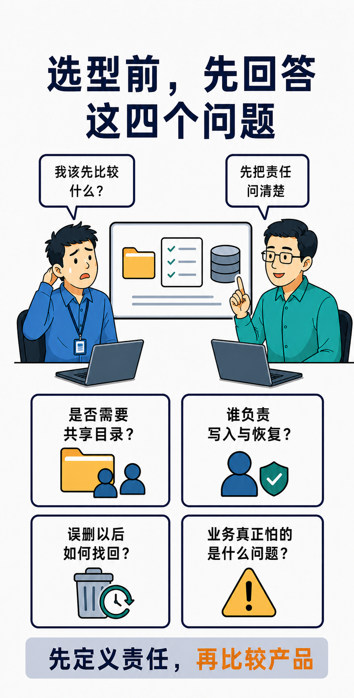

# Q006：块、文件、对象三种数据接口分别适合什么负载？

> 文中的业务场景为假设场景，用来说明决策方法，不对应任何客户或性能数据。

块、文件、对象并不是三种容量套餐，而是三份不同的责任合同。块接口把一段可寻址的字节交给主机；文件接口把目录、名字、权限和部分并发语义交给文件服务；对象接口把数据组织成“桶 + 键 + 元数据”的 API 模型。真正决定是否适合的，不是“哪一个更快”，而是业务愿意把文件系统、锁、命名空间、版本和生命周期分别交给谁负责。

这也是接口选型最容易被简化错的地方。数据库、设计资料和训练产物都可能占用同样多的容量，但它们对写入、共享和恢复的要求并不相同。把它们统一塞进“一个大存储”，不等于它们就该使用同一种访问接口。

假设一个内部数据平台同时承载三类工作：容器化数据库需要稳定的数据目录；多个团队要协作编辑工程资料；数据处理任务持续产生可追溯的中间结果和发布物。若把问题问成“块、文件、对象谁最先进”，讨论会很快滑向产品名和跑分。更有用的问法是：**谁维护命名空间？谁协调并发写入？谁证明删除或覆盖后仍能恢复？谁在故障时接管写入权？**

## 块接口：把控制权交给主机，也把责任留在主机

块存储提供的是按地址读写的逻辑设备，而不是现成的目录树。主机或上层软件还要决定其上运行什么文件系统、如何组织日志和缓存、何时发出持久化写入、如何做卷管理，以及多主机是否可以同时写入。

这正是块接口适合数据库、虚拟机磁盘和部分需要自行控制 I/O 路径的系统的原因：它们通常已经有成熟的文件系统、数据库页管理或虚拟化层，不需要存储系统替它们定义共享目录的行为。但“控制力更强”不是“责任更少”。原始块设备上没有现成文件系统；应用必须知道如何格式化、挂载、写入、恢复，并明确谁拥有写入权。

因此，不能因为两台主机都能看到同一块盘，就把它当作多人共享目录。多写者需要集群文件系统、数据库集群协议，或明确的单写者与故障隔离机制。否则，两台主机各自把同一块盘当成本地磁盘使用，风险不是“性能可能不好”，而是文件系统或应用数据可能被破坏。

块接口的 PoC 不该只测 IOPS。对数据库卷，至少要验证：同步写的完成语义是否符合应用预期；主机或链路故障后，旧写入者是否已被隔离；卷重新挂载后，文件系统和数据库各自如何恢复。若这些问题没有答案，“高性能块存储”只是把风险移到了主机一侧。

## 文件接口：买到的不只是空间，而是共享命名空间

文件接口把目录、文件名、权限、属性、打开/关闭状态以及锁等行为作为服务的一部分交付。NFSv4.1 的 `OPEN` 操作可以原子地查找、创建并锁定文件，协议也定义了字节范围锁及其状态标识。[RFC 8881：NFSv4.1](https://www.rfc-editor.org/rfc/rfc8881.html) 这类语义使文件接口天然适合协作目录、工程资料、用户家目录、媒体素材和需要多客户端遵循同一文件命名空间的工作流。

但“支持 NFS 或 SMB”不是一句足以验收的承诺。文件工作负载常常先被元数据动作拖慢：创建海量小文件、递归遍历目录、频繁 `stat`、权限检查、`open/close`，以及对同一文件的锁竞争，都可能比大块顺序读写更早到达瓶颈。与此同时，客户端缓存、挂载参数、身份映射和协议版本会改变业务实际看到的一致性与故障恢复行为。

所以，文件接口适合的前提不是“文件多”，而是业务确实需要共享文件语义。PoC 应让多个真实客户端并发创建、重命名、遍历和修改文件；验证锁冲突、权限变更、客户端重启和网络中断后的行为；再看目录元数据、锁等待和失败重试，而不是只看单客户端吞吐量。

## 对象接口：把数据管理改写成 API 与生命周期问题

对象接口不把一个可挂载的文件系统交给客户端，而是让应用通过 API 管理对象、对象名和元数据。很多对象系统会用前缀在界面上呈现“文件夹”，但它并不天然等同于一棵可由多个客户端按文件系统规则共同修改的目录树。

这种模型适合备份、归档、数据集、镜像、日志、媒体资产和可按对象组织的中间产物。它的优势不只在容量扩展，更在于可以把版本、保留、标签、复制与生命周期作为数据治理的一部分。不过，应用也必须面对 API 语义：更新一个对象时是否需要重写完整对象？多个任务同时写同一对象名时，谁的结果保留？删除后是否还有可恢复版本？这些行为取决于所选服务与配置，必须在设计和 PoC 中逐项确认。

因此，对象接口不适合被简单地当成“更大的共享盘”。若应用依赖目录级原子改名、原地小范围修改、POSIX 文件锁或低时延同步写确认，直接把路径换成对象键，通常只是把兼容性问题推迟到网关、FUSE 层或应用代码里。对象 PoC 应验证同键并发写、覆盖与误删的恢复路径、版本和保留策略是否真正启用，以及生命周期动作是否符合成本和恢复目标。

## 三种接口如何落到真实负载

| 业务首先依赖什么 | 更可能合适的接口 | 责任与风险要点 |
|---|---|---|
| 主机/数据库/虚拟化栈自行管理文件系统和写入顺序 | 块 | 文件系统、单写者或集群协调、路径故障与恢复由主机侧证明 |
| 多客户端共享同一目录、权限和文件协作语义 | 文件 | 元数据、锁、客户端缓存、身份映射和协议故障行为必须验收 |
| 以对象、版本、标签、保留和批量数据管道组织数据 | 对象 | 应用要适配 API 写入与并发语义；版本和生命周期必须配置并演练 |

这张表不是排他规则。数据库可以部署在文件系统上，块设备上也可以建立文件服务，对象存储也可以通过网关提供类文件访问；同一后端甚至可以同时交付三种接口。问题在于，每增加一层适配，就多一层需要明确其语义、性能边界和故障责任的组件。接口不是后端实现的别名，更不是“能挂载”或“能访问”就算满足业务。

## 选型会前，我会先要四个答案

1. 应用是否依赖目录树、原子重命名、文件锁或多客户端共享？
2. 若交付的是块设备，文件系统、单写者限制、故障隔离和恢复由谁实施并验证？
3. 若交付的是对象 API，覆盖、并发写、误删、版本与保留如何落成可演练的策略？
4. 目标负载中，真正先到达上限的是数据吞吐、I/O 时延、目录元数据、锁等待，还是 API/网络重试？

能回答清楚这四个问题，才有资格比较协议、产品和报价。答案若仍是“数据量有多少、谁的 IOPS 更高”，说明业务需要的访问语义和责任边界还没有被定义出来。

> **证据边界**：本文引用的是协议、平台或单一实现的公开文档，用于说明接口的责任边界；不据此推导任何厂商的性能、兼容性或可用性结论。具体驱动、协议版本、客户端参数、故障切换和恢复结果，仍须在目标版本与真实负载下通过 PoC 验证。

## 参考资料

- [RFC 8881：Network File System Version 4 Minor Version 1 Protocol](https://www.rfc-editor.org/rfc/rfc8881.html)

## 关联问题

- Q002：NAS、SAN 与对象存储的差别是什么？
- Q022：文件锁、缓存一致性与协议选择有什么关系？
- Q029：对象存储的 S3 API 与传统文件系统如何协同？
