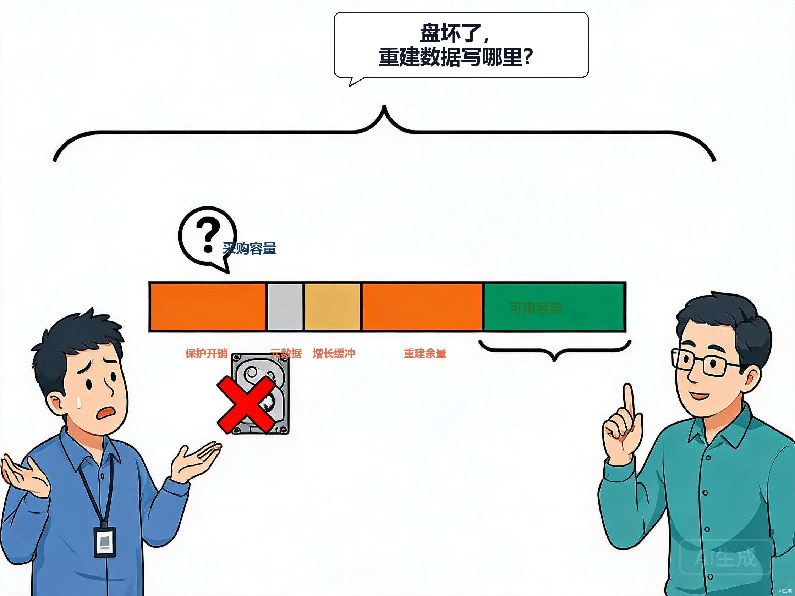
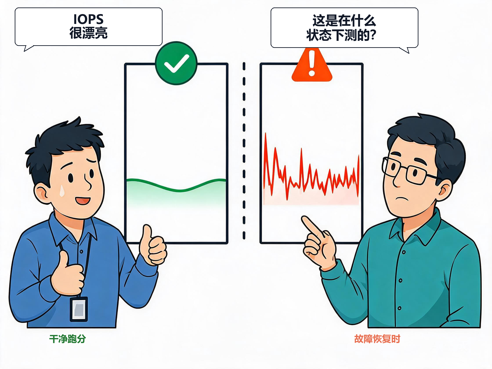
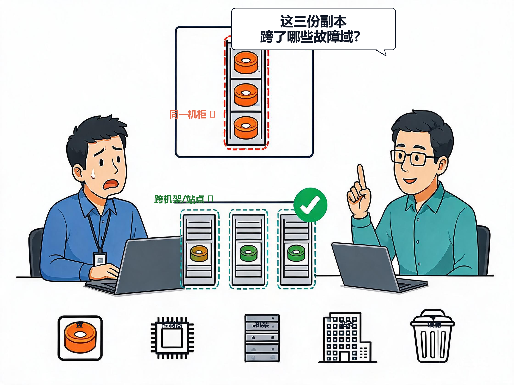
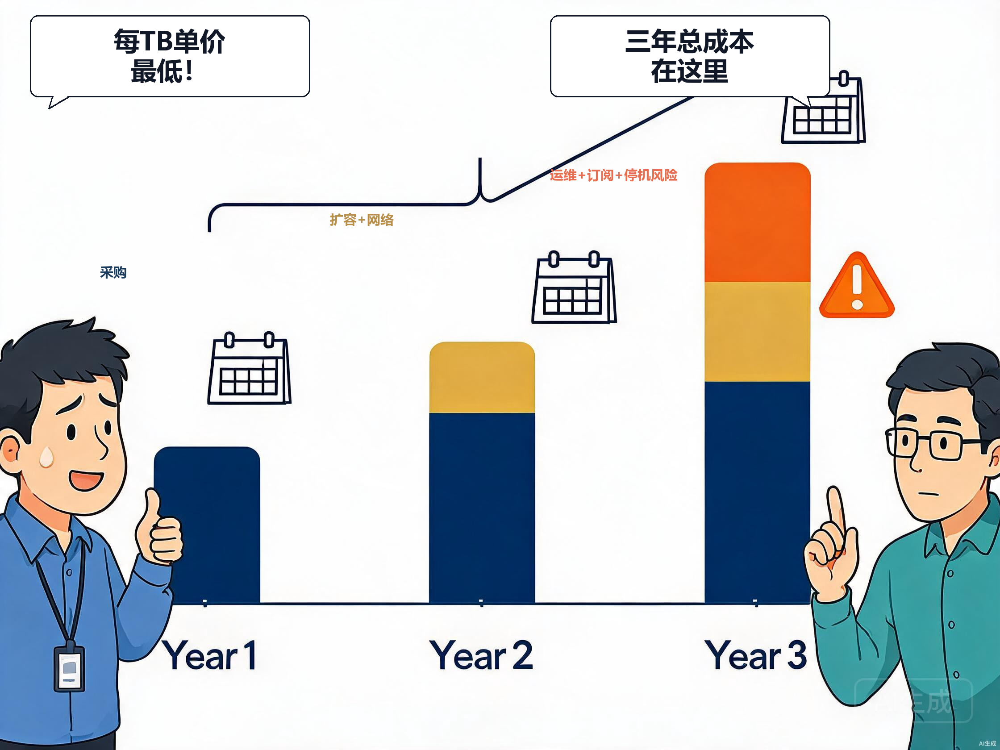

# Q007：容量、性能、可靠性和成本为什么不能独立决策？

> 文中的业务场景为假设场景，用来说明架构判断方法，不对应任何客户、产品报价或性能数据。

容量、性能、可靠性和成本不是存储选型表上的四个独立评分项。它们是同一个业务承诺的四种投影：业务要在多大的数据规模下，以多快的响应，在什么故障条件下继续服务，并允许为此付出多少采购、运营与恢复代价。只拿其中一项单独做“最优”，往往会把代价推给另外三项。

假设一个数据平台准备扩容。团队提出的目标听起来很完整：容量要够未来增长，日常读写不能慢，关键数据不能丢，预算还要尽量低。于是有人先按原始 TB 报价筛选，再找一份 IOPS 规格表补齐性能项，最后加上“有双控、有副本”作为可靠性说明。

问题在于，这些答案彼此还没有相遇。若容量接近边界，故障后的重建或重平衡可能没有空间落盘；若把恢复流量压得过低以保护在线时延，恢复窗口又会拉长；若增加副本、保留版本或更严格的恢复能力，可用容量和运营成本都会改变。真正需要设计的不是四张表，而是它们交叉处的故障和高峰场景。

## 容量从来不只是采购容量

业务能使用的容量，不等于硬盘标签相加。它还要扣除数据保护方式、系统元数据、预留空间、增长缓冲、快照或版本保留，以及在故障期间用于恢复和重分布的余量。数据缩减可以改善某些负载下的空间效率，但不能在选型阶段被当作没有前提的固定折扣；数据类型、可压缩性、去重范围和写入方式都需要由真实样本验证。

更关键的是，余量不是财务上的“闲置”。在有副本、重建或数据重分布能力的系统里，它是故障处理能力的一部分。系统即使没有立刻丢失数据，若没有地方承接恢复后的数据，或恢复期间把池、阵列或网络推到容量边界，业务仍可能被限速、中断或长期运行在降级状态。

无论是阵列重建、存储池扩容，还是跨节点副本修复，恢复都需要额外的落点、I/O 和网络带宽。容量规划因此必须先写清楚：计划覆盖哪一级故障域、故障发生时允许以什么速度恢复、恢复期间业务还能接受多少延迟和吞吐下降。只按“当前已用容量 + 增长率”采购，通常没有回答这些问题。

## 性能不是一份脱离容量和故障的跑分

性能指标也必须放回负载中理解。平均 IOPS、最大带宽或一次干净环境下的低时延，不能证明高峰、后台任务和故障恢复同时发生时仍能满足业务。数据库的同步写、虚拟化集群的混合 I/O、文件服务的元数据操作、对象存储的并发 PUT/LIST，对队列、缓存、网络和介质的压力完全不同。

恢复尤其会把性能和可靠性绑在一起。重建、数据回填或重新分布都要与新请求竞争介质、CPU、网络和队列资源。这里的架构信号很直接：**承诺恢复得更快，往往需要预留更多资源；把资源全部让给前台，恢复目标就要重新评估。**

所以我不会接受“正常压测 P99 达标”作为性能验收的终点。我会要求同一份 PoC 至少包含正常高峰、快照/备份窗口、容量接近阈值，以及单个介质或节点故障后的恢复阶段。业务真正购买的是这些阶段都可接受的体验，而不是某一小段无干扰的曲线。

## 可靠性不是多加一层副本就结束了

可靠性的第一个问题不是“有几份副本”，而是“它们跨过了哪些故障域”。单盘、控制器、主机、机架、站点、误删除和勒索攻击，不是同一种故障；RAID、跨主机副本、快照、备份和不可变副本各自只覆盖其中一部分。保护层数增加，往往会改变可用容量、写入路径、恢复时间、管理复杂度和成本。

可靠性还必须用恢复目标来约束。NIST 的应急规划指南强调，组织需要评估系统与运行的应急需求和优先级；这意味着“数据很重要”不能直接转成一个技术配置，仍要落到恢复顺序、恢复点和恢复时限。[NIST SP 800-34 Rev.1](https://csrc.nist.gov/pubs/sp/800/34/r1/upd1/final)

例如，某个可从源头重新计算的临时数据集，可能接受较低的保护等级；而交易数据库的一小段日志缺失，可能无法接受。前者若强行采用与后者同样的副本、保留和介质等级，是成本浪费；后者若只因为“昨晚有备份”就选择最低成本容量，则把恢复风险留给业务。架构师的工作不是给每类数据贴“高、中、低”标签，而是把故障后必须保住什么、多久恢复、谁验证恢复，写成可以演练的约束。

## 成本是系统全生命周期的代价，不是每 TB 单价

采购价当然重要，但它不是唯一成本。为了获得更高性能，可能要支付更高的介质、网络、控制器或容量余量成本；为了获得更高可用性，可能要支付副本、异地链路、备份平台和演练成本；为了压低前期投入，又可能把扩容频率、性能治理、恢复操作和人工排障转移给运行团队。

这里没有一条脱离场景的“最低 TCO”公式。我的判断是：任何方案若没有把三年内的数据增长、保护保留、扩容窗口、能耗/机柜/链路、许可订阅、运维工时，以及一次无法按目标恢复的业务风险放进同一张账，就只能比较采购单，不能比较总成本。

自动化供给平台会让这种错觉更强。它可以把不同存储能力包装成“高性能”“标准”或“备份”等名称，但名称本身不规定具体的时延、保护或成本承诺。因此，名称不是成本模型，更不是服务等级协议；每个等级都需要对应明确的容量、性能、保护和计费边界。

## 一次选型，应该同时证明四件事

| 需要证明的事 | 不能只看的数据 | 还必须同时观察什么 |
|---|---|---|
| 容量够用 | 原始容量、当前使用率 | 保护开销、增长、热点分布、恢复余量与可扩展路径 |
| 性能可用 | 峰值 IOPS、平均时延 | I/O 分布、P99、并发、元数据、备份/重建期间的业务体验 |
| 故障可控 | 副本数、控制器数量 | 故障域、fencing、RPO/RTO、恢复顺序和演练证据 |
| 成本合理 | 每 TB 单价、初始采购额 | 三年扩容、保护、网络、订阅、能耗、运维与停机风险 |

这四件事必须在同一批场景中验收。举例说，若容量验证只填满数据、性能验证只在空闲时跑、可靠性验证只看配置截图、成本验证只看第一年报价，那么四项即使分别“通过”，也无法证明系统在真实高峰或故障时能兑现承诺。

## 我会把 PoC 从规格比较改成约束验证

在启动 PoC 前，我会先收集七类输入：有效数据量与增长、数据保留与可恢复范围、I/O 大小和读写/同步比例、并发与 P99 目标、正常与故障时的服务目标、RPO/RTO、可接受的三年成本边界。缺少其中任何一项，都不应急于要求厂商给出“推荐型号”。

随后用相同的数据集和业务操作跑四类场景：

1. 正常高峰下的真实请求分布；
2. 备份、快照、复制或批处理与前台并发；
3. 容量接近预警线时的扩容或数据重分布；
4. 介质、节点或路径故障后的降级、恢复与数据校验。

验收结果也不能只写“通过”。需要记录每个场景的业务错误、P99、队列和恢复进度，确认可用容量如何变化、恢复是否在目标窗口内完成、故障期间谁负责处置，以及方案边界外会发生什么。这样得出的结论才是“这个方案适合这份业务承诺”，而不是“它有更高规格”。

## 什么时候可以简化这四项耦合？

对可丢弃、可重建、单一开发团队使用且允许较长恢复时间的非关键数据，确实可以选择较低成本的方案，并减少保护与性能余量。这里的关键不是技术等级低，而是业务已明确接受相应后果。

反过来，只要数据跨团队共享、承载交易或生产服务、需要跨故障域恢复，或者扩容与恢复会影响在线业务，四项就不能再分开审批。此时最危险的不是“没有买到最高规格”，而是用一份容量报价替代了一份业务承诺。

> **证据边界**：本文用通用机制说明恢复目标、容量余量与供给策略的关系，不提供任何产品阈值或成本数字。实际可用容量、性能、恢复时间和全生命周期成本，均须以目标版本、配置、数据集与 PoC 演练验证。

## 参考资料

- [NIST SP 800-34 Rev.1：Contingency Planning Guide](https://csrc.nist.gov/pubs/sp/800/34/r1/upd1/final)

## 关联问题

- Q010：存储选型前必须收集哪些业务数据？
- Q012：存储的可用容量为什么常常小于采购容量？
- Q014：什么是 RPO 与 RTO，它们如何影响存储设计？
- Q079：厂商 PoC 应验证哪些真实场景？
